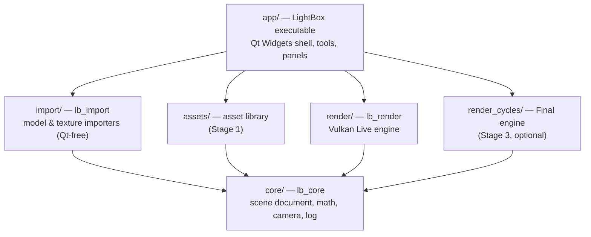

# AGENTS.md — The LightBox AI Readme

> **Every AI agent working on LightBox starts here.** Read this file completely, then
> [`docs/PROGRESS.md`](docs/PROGRESS.md) (where the project is right now) and the current
> substage in [`docs/ROADMAP.md`](docs/ROADMAP.md). Humans are welcome too; the human-facing
> overview is [`README.md`](README.md).

---

## 1. What LightBox is

**LightBox** (always styled exactly like that: capital L, capital B, one word) is a free,
open-source (MIT), desktop **architectural visualization and rendering application** for
small architecture practices, landscape architects, interior designers and students who
cannot pay for Enscape / Lumion / Twinmotion / D5 / V-Ray subscriptions but want the same
convenience and quality.

The promise, in one sentence:

> *Drop in your plans and model, get a beautiful image in five minutes, and a
> photoreal final render when you need it, on the laptop you already own.*

Two render engines, one scene:

| Engine | Purpose | Technology | Class of competitor |
| --- | --- | --- | --- |
| **Live** | Interactive design review, walkthroughs, video, instant stills | Our own Vulkan real-time renderer (raster + optional hardware ray tracing) | Enscape, Lumion, Twinmotion, D5 |
| **Final** | Photoreal stills / panoramas / animations | [Cycles](https://www.cycles-renderer.org/) (Apache-2.0) embedded as a library | V-Ray, Corona |

Both engines read the *same* LightBox scene, materials, lights and cameras. The user never
re-does work to switch engines.

## 2. Session protocol (how to pick up work)

LightBox is built by many AI sessions over a long time. Sessions are deliberately small.

1. **Orient** (read, don't code yet):
   - this file,
   - [`docs/PROGRESS.md`](docs/PROGRESS.md) → *Current position* and the latest handoff entry,
   - the current substage in [`docs/ROADMAP.md`](docs/ROADMAP.md),
   - the sections of [`docs/ARCHITECTURE.md`](docs/ARCHITECTURE.md) your work touches,
   - [`docs/WORKFLOW.md`](docs/WORKFLOW.md) for anything user-facing (which mode a feature belongs to,
     the journeys it serves),
   - [`docs/DECISIONS.md`](docs/DECISIONS.md) before changing anything foundational.
2. **Scope one substage** (e.g. `1.3`). Do not drift into the next substage or stage. If the
   substage is clearly bigger than one focused session (rule of thumb: more than ~1,500 changed
   lines or ~15 files), split it first (`1.3a`, `1.3b`, …) in `ROADMAP.md`, then do only the first part.
3. **Build it** following the rules in §6–§10.
4. **Verify it** (§11). Build clean, run the app, exercise the change, look at a screenshot.
5. **Hand off** before you stop:
   - tick the substage in `ROADMAP.md` (`[x]` done, `[~]` partially done with a note),
   - add a dated entry at the top of the *Session log* in `PROGRESS.md` and update *Current position*
     (template is in the file),
   - record any new foundational choice in `DECISIONS.md` (new dependency, convention, format change),
   - keep docs truthful: if your change makes a statement in any doc wrong, fix the doc in the same session.

**If the user gives you a different instruction, the user wins.** Record deviations in `PROGRESS.md`.

## 3. Product principles (the "LightBox feel")

These decide every UX and engineering trade-off. When in doubt, re-read them.

1. **Easy by default, powerful on demand.** Every feature has a one-click/default path; advanced
   controls live behind *Advanced* disclosure, never in the user's face.
2. **Speak architect, not game engine.** UI says *Materials, Sun & Sky, Entourage, Views, Storeys,
   Planting*, never *shaders, actors, prefabs, blueprints*. See [`docs/DOMAIN.md`](docs/DOMAIN.md).
3. **Drag and drop everything.** Models, plans, texture folders, HDRIs, assets: drop them on the window
   and LightBox figures out the rest (units, up-axis, PBR maps, scale). Dialogs only when a decision is
   genuinely ambiguous, and then with a good default pre-selected.
4. **Beautiful immediately.** A freshly imported model must already look good: sun, sky, ground, exposure
   and clay/default materials are set up automatically. No black screens, no "now configure lighting".
5. **Never lose work.** Autosave, crash recovery, undo for everything, non-destructive edits.
   **Re-importing an updated model keeps every material/asset assignment** (architects iterate constantly).
6. **Runs on a laptop, scales to a workstation.** The minimum target is an Intel Iris Xe-class iGPU with
   8 GB RAM (the original dev machine). Hardware ray tracing is an *enhancement tier*, never a requirement.
7. **Premium feel.** Consistent design system, no UI stalls (>16 ms on the UI thread is a bug), smooth
   viewport, crisp typography, polished empty states, progress + cancel for every long operation.
8. **Teach in place, then get out of the way.** Every tool, panel and setting explains itself through
   Fusion-style rich tooltips and small ⓘ info buttons that show *how to do it*, never through blocking
   dialogs. Experienced users turn it down or off with one setting (*Preferences ▸ Help ▸ How-to tips*).
9. **Offline and private.** No account, no cloud requirement, no telemetry unless the user opts in.
10. **Open and honest.** Only license-compatible dependencies (§9). Asset packs carry their licenses and
    attribution is exportable.

## 4. The stages (summary)

Full detail, substages and acceptance criteria: [`docs/ROADMAP.md`](docs/ROADMAP.md).

| Stage | Name | Essence |
| --- | --- | --- |
| 0 | **Foundation** | Build system, app shell, Vulkan viewport, scene document, save/load, undo, CI. The framework skeleton everything else plugs into. |
| 1 | **Import** | Plans (DXF/DWG/PDF/images), models (glTF, OBJ, FBX, SKP, 3DM, IFC…), textures/PBR sets, props and plants, all *easily*, with live re-import. |
| 2 | **Interface & workflow** | Premium UI: design system, mode-based workflow, tools, inspector, asset browser, views, project management. |
| 3 | **Light & render** (the big one) | Live engine to Lumion/D5 quality (physical sun/sky, GI, reflections, RT tier) + Cycles Final engine, output, animation. |
| 4 | **Water** | Pools, infinity edges, fountains, jets, sheet falls, runnels, cascades: parametric, physically shaded. |
| 5 | **Environment** | Terrain + terraforming, site data, sky & weather, vegetation ecosystems, natural water, biomes. |
| 6 | **Release & ecosystem** | Installers, updates, live-link plugins for SketchUp/Revit/Rhino, docs, asset hub. |

Stage 0 exists because importing (Stage 1) needs an app to import *into*; Stage 2 still owns the full
UI/workflow design and the final project file format. See `DECISIONS.md` D-009.

## 5. Tech stack

Decided by the project owner on 2026-10-14 (`DECISIONS.md` D-001). Do not propose switching stacks.

| Layer | Choice | Notes |
| --- | --- | --- |
| Language | **C++20** | No compiler extensions. `std::format` is available. |
| Build | **CMake ≥ 3.25 + Ninja**, `CMakePresets.json` | Dependencies via `FetchContent`, pinned to tags (`cmake/LightBoxDependencies.cmake`). |
| UI shell | **Qt 6 Widgets** (min 6.8, tested 6.10.3) | LGPL, dynamically linked. Viewport is a native `QWindow` embedded with `QWidget::createWindowContainer`. |
| GPU API | **Vulkan 1.3** baseline | `dynamicRendering`, `synchronization2`, `bufferDeviceAddress` required. Ray tracing optional tier. |
| Vulkan loading | [volk](https://github.com/zeux/volk) | No link-time Vulkan SDK needed; loads `vulkan-1` at runtime. |
| GPU memory | [Vulkan Memory Allocator](https://github.com/GPUOpen-LibrariesAndSDKs/VulkanMemoryAllocator) | All buffers/images go through VMA. |
| Math | [GLM](https://github.com/g-truc/glm) | Column-major, radians. |
| Shaders | **GLSL → SPIR-V** at build time with glslang | Embedded into the binary as generated headers. Built from source if no Vulkan SDK. |
| Final renderer | **Cycles** (Apache-2.0), Stage 3.10 | Requires MSVC on Windows. Optional CMake feature `LIGHTBOX_WITH_CYCLES`. |
| Denoiser | Intel Open Image Denoise (Apache-2.0) | Stage 3. |
| Toolchains | Windows: **MSVC 2022 (canonical)** or MinGW 13.1 (no-admin/dev, no Cycles); Linux: GCC 13+/Clang 17+; macOS later via MoltenVK | `DECISIONS.md` D-007. |

## 6. Architecture at a glance

Detail: [`docs/ARCHITECTURE.md`](docs/ARCHITECTURE.md).



**Layering rules (enforced by CMake link dependencies — keep it that way):**

- `core` depends on the standard library and GLM only (plus stb_image privately, for `core/image.*`).
  **No Qt, no Vulkan** in core.
- `import` (lb_import) depends on core and single-file parsers (cgltf, tinyobjloader, ufbx). **No Qt, no
  GPU.** Parsing runs on worker threads and returns plain data; only `addToScene` touches the `Scene`,
  on the UI thread.
- `render` depends on core + Vulkan stack. **No Qt** in render. It must be able to render headless
  (batch/CLI renders later).
- `app` is the **only** place Qt is used. It may use Vulkan *handles* only for Qt interop
  (`VkInstance`, `VkSurfaceKHR`).
- Feature areas (water, terrain, vegetation) are split by layer: data model in `core/<feature>/`,
  GPU code in `render/<feature>/`, UI in `app/<feature>/`. Never a feature module that mixes layers.

**World conventions (never break these; importers convert *into* them):**

| Quantity | Convention |
| --- | --- |
| Length | **meters** (UI displays the project's unit system: mm, cm, m, ft-in) |
| Axes | **right-handed, Z-up**; +Y is project north until geolocation sets a north offset |
| Angles | radians in code, degrees in UI |
| Depth | **reverse-Z** with infinite far plane (depth 1 = near, 0 = infinity, compare `GREATER`) |
| Clip space | Vulkan (y down, depth 0..1); the projection matrix flips Y |
| Color | scene-referred **linear** Rec.709 primaries; color textures are sRGB-encoded; swapchain is sRGB |
| Light units | sun in lux, lights in lumens/candela, emission in nits, color temperature in Kelvin (Stage 3) |
| Geometry | **two-sided by default** (CAD exports have unreliable winding); normals flipped toward the viewer in shading |
| Large coordinates | models far from origin (georeferenced CAD) are recentered with a stored origin offset (Stage 1) |

## 7. Repository map

```
lightbox/
├─ AGENTS.md               ← you are here (AI readme)
├─ CLAUDE.md               ← pointer to AGENTS.md for tools that look for it
├─ README.md               ← human-facing overview
├─ CMakeLists.txt          ← top-level build
├─ CMakePresets.json       ← configure/build presets (mingw-*, msvc-*, linux-*)
├─ branding/               ← logo/icon SVG masters + PNG/ICO exports; alt/ = original isometric variant
├─ cmake/                  ← Dependencies, Shaders, Warnings helper modules
├─ docs/
│  ├─ ROADMAP.md           ← stages → substages → acceptance criteria (the plan)
│  ├─ PROGRESS.md          ← current position + session handoff log
│  ├─ ARCHITECTURE.md      ← modules, data model, render design, file formats
│  ├─ DECISIONS.md         ← numbered decision records (why things are the way they are)
│  ├─ DOMAIN.md            ← architecture/landscape primer for AIs + competitor notes
│  ├─ WORKFLOW.md          ← modes, workspaces, start screen, user journeys (UX source of truth)
│  └─ BUILDING.md          ← toolchain setup and build instructions
└─ src/
   ├─ core/                ← lb_core: log, camera, mesh data, scene document, selection, environment
   ├─ render/              ← lb_render: Vulkan context, presenter (swapchain), pipelines
   │  └─ shaders/          ← GLSL sources, compiled to SPIR-V at build time
   └─ app/                 ← LightBox.exe: main window, docks (outliner, inspector), viewport, theme
      └─ resources/        ← bundled Inter font + Lucide icons (with license files)
tests/                     ← doctest unit tests (no GPU, no Qt)
```

## 8. Build & run (short version)

Full instructions, including a no-admin Windows setup: [`docs/BUILDING.md`](docs/BUILDING.md).

```sh
cmake --preset mingw-debug        # or msvc-debug / linux-debug
cmake --build --preset mingw-debug
build/mingw-debug/src/app/LightBox.exe
ctest --preset mingw-debug       # unit tests (tests/, doctest, no GPU needed)
```

Useful flags (all real, implemented in `src/app/main.cpp`):

| Flag | Effect |
| --- | --- |
| `--validation` | Enable Vulkan validation layers (needs the Vulkan SDK installed) |
| `--screenshot <file.png>` | Capture the main window (or gallery) after startup and exit, for visual verification |
| `--screenshot-delay <ms>` | Wait before capturing (default 2000), e.g. to script clicks first |
| `--quit-after <ms>` | Exit automatically (smoke tests) |
| `--theme dark\|light` | Start in a theme (overrides the saved preference) |
| `--gallery` | Open the design gallery (every styled control, tokens, icons) instead of the app |
| `--mode <name>` | Start in a workflow mode: `import`, `build`, `materials`, `site`, `light`, `render` |
| `--import <file>` | Import a model, or texture images as one material, after startup (repeatable); keeps `--mode` if given |

Logs go to stderr and to `%LOCALAPPDATA%/LightBox/logs/lightbox.log`
(`~/.local/share/LightBox/logs` on Linux). The previous run is kept as `lightbox.prev.log`.

## 9. Dependency & license policy

LightBox is MIT. Every dependency must keep it distributable as open source.

- **Allowed in-process:** MIT, BSD-2/3, Apache-2.0, zlib, ISC, Boost, MPL-2.0, public domain/Unlicense/CC0.
- **Allowed only dynamically linked:** LGPL (Qt, IfcOpenShell, FFmpeg LGPL builds).
- **Forbidden in-process:** GPL/AGPL (e.g. LibreDWG, libdxfrw, Qt GPL-only modules such as Qt Quick 3D).
  A GPL tool may only be invoked as a separate, user-installed executable.
- **Proprietary SDKs** (e.g. SketchUp SDK, ODA): optional plugin modules, off by default, never required for
  the core build, redistribution terms checked and recorded in `DECISIONS.md`.
- **Fonts/icons/assets:** OFL/ISC/MIT/CC0 only. Assets are **not** committed to the repo; they ship as
  downloadable packs with a license manifest.
- **Adding a dependency:** pin a tag in `cmake/LightBoxDependencies.cmake`, add it to the stack table in
  `ARCHITECTURE.md`, and record the reason + license in `DECISIONS.md`. Prefer small, single-purpose libraries.

## 10. Coding conventions

- **Style:** `.clang-format` at repo root (LLVM-based, 4-space indent, 100 columns). Match surrounding code.
- **Naming:** types `PascalCase`; functions/methods/variables `camelCase`; private members `trailing_`;
  constants `kPascalCase`; namespaces lowercase (`lb`, `lb::render`, `lb::app`); files `snake_case.cpp/.hpp`.
- **Includes** are rooted at `src/`: `#include "core/camera.hpp"`, `#include "render/renderer.hpp"`.
- **Headers:** `#pragma once`; public render headers stay Vulkan-light (pimpl, opaque handles).
- **Errors:** exceptions for unrecoverable setup failures (device creation, missing GPU features) and at
  import boundaries; they are caught in `app` and shown to the user in plain language. **No exceptions in
  per-frame code paths.** `LB_VK_CHECK` wraps every fallible Vulkan call.
- **Ownership:** RAII / `std::unique_ptr`; no naked `new`/`delete`. Vulkan objects are destroyed by their owner
  in reverse creation order.
- **Threads:** the scene document is mutated on the UI thread through commands (Stage 0.7). Heavy work
  (imports, texture compression, thumbnails) runs in background jobs with progress and cancellation.
- **Vulkan:** validation-clean under `--validation`. Never assume a feature beyond the 1.3 baseline without a
  capability check and a fallback. Keep per-frame allocations at zero.
- **UI:** colors/spacing/fonts come from the theme (`src/app/theme.*`, expanded into a design system in 2.1a),
  never hard-coded in widgets. Every user action is undoable once the command system exists (0.7).
- **Help:** from substage 2.1b on, every new action, tool, panel and setting registers a help entry (summary,
  how-to steps, shortcut) by help ID; a feature without its help entry is not done.
- **Brand:** the logo is a cube seen from a low camera (22° elevation, 45° yaw), lit from the left, with
  its shadow cast in front of the dark face; the wordmark stands in the plane of the lit face, "Light" in a
  light weight and "Box" in a bold weight (Jost, converted to outlines). Masters live in `branding/*.svg`;
  regenerate PNG/ICO exports from them with an SVG rasterizer (resvg, Inkscape), never edit exports by
  hand. Palette: lit face `#A3E3FB→#6FCBF2`, top `#2BB8F7→#0B93DE`, shade face `#4A4CDB→#2F2FAE`,
  ink/shadow `#141A3A`. The UI accent is the top-face azure `#1FA7F0`.
- **Comments** explain *why*, not *what*. No commented-out code, no TODO placeholders in shipped paths: open
  work belongs in `ROADMAP.md`.

## 11. Definition of done & verification

A substage is done when **all** of these hold:

1. Every acceptance criterion listed for it in `ROADMAP.md` is met end-to-end (not a stub, not a subset).
2. It builds warning-clean with at least one preset (record which in `PROGRESS.md`).
3. You **ran the app** and exercised the change. For anything visual, capture
   `LightBox --screenshot shot.png` and look at the image. Under `--validation` there are no Vulkan errors
   when the SDK is available.
4. Unit tests (`tests/`, doctest, run with `ctest --preset <preset>`) cover real behavior: document
   invariants, units/conversion math, importers on small fixture files, file format round-trips,
   undo/redo correctness. GPU-facing logic is tested through injected fakes. No tests that only restate
   the code.
5. Docs updated: `ROADMAP.md` checkbox, `PROGRESS.md` handoff entry, and any doc your change made untrue.

## 12. Things not to do

- Don't turn LightBox into a game engine (no physics gameplay, no scripting runtime, no networking) or a
  modeler (LightBox places, arranges and dresses; modeling stays in SketchUp/Revit/Rhino). Exceptions are
  the explicit site tools in the roadmap: plan-to-3D massing, terrain, pads, paths, water features.
- Don't require hardware ray tracing, a discrete GPU, an internet connection or an account.
- Don't break saved projects: format changes need a version bump + migration (Stage 0.6 onward).
- Don't commit binaries, build outputs, large assets or credentials. `build/` is ignored.
- Don't add a dependency without following §9.
- Don't silently reduce a substage's scope; split it in `ROADMAP.md` instead.
