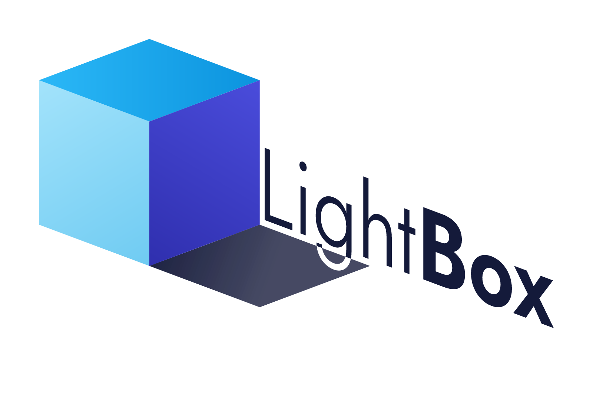

<p align="center">
  
</p>

# LightBox

**Free, open-source architectural rendering for small practices.**

LightBox aims to give small architecture, landscape and interior design studios the convenience of
Enscape/Lumion-style real-time visualization and the quality of a production path tracer, without the
subscription. Drop in your plans and model, get a beautiful image in minutes, and a photoreal final render
when you need it, on the laptop you already own.

> **Status:** early development, Stage 0 (Foundation). Nothing here is usable for production yet.
> See [`docs/ROADMAP.md`](docs/ROADMAP.md) for the plan and [`docs/PROGRESS.md`](docs/PROGRESS.md) for
> where things stand.

## Planned highlights

- **Easy import:** plans (DXF/DWG via converter/PDF/images), models (glTF, OBJ, FBX, SketchUp, Rhino, IFC),
  PBR texture sets, props and plants, all by drag and drop, with re-import that keeps your materials.
- **Premium, architect-friendly interface** built on Qt.
- **Two engines, one scene:** a Vulkan real-time engine (*Live*) for design review and video, and
  [Cycles](https://www.cycles-renderer.org/) (*Final*) for photoreal stills, panoramas and animations.
- **Water:** pools, infinity edges, fountains, jets, sheet falls, runnels and cascades.
- **Environment:** terrain and terraforming, physical sun/sky, weather, vegetation ecosystems, natural water.

## Building

See [`docs/BUILDING.md`](docs/BUILDING.md). Short version (with Qt 6 and a C++20 compiler set up):

```sh
cmake --preset mingw-debug
cmake --build --preset mingw-debug
```

## Contributing (humans and AIs)

Start with [`AGENTS.md`](AGENTS.md): it explains the vision, architecture, conventions and the
stage-by-stage workflow every contributor follows.

## License

[MIT](LICENSE). Third-party components keep their own licenses; see `docs/DECISIONS.md` for the
dependency license policy.
