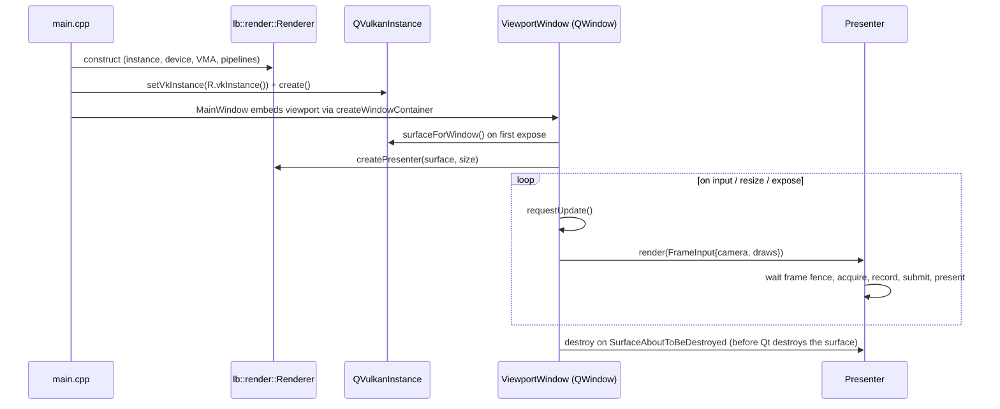

# LightBox Architecture

How the pieces fit, what exists today, and the designs later stages build toward. Sections marked
**(planned, N.N)** describe intent for roadmap substage N.N; the implementing session refines them and
updates this file.

## 1. Modules

| Module | Target | Depends on | Status | Responsibility |
| --- | --- | --- | --- | --- |
| `src/core` | `lb_core` (static) | std, GLM | Stage 0 | Logging, camera math, CPU mesh data, primitives, the scene document (`core/scene/`), sample massing. Gains project IO (0.6), commands/undo (0.7), jobs (1.1). |
| `src/render` | `lb_render` (static) | core, Vulkan-Headers, volk, VMA | Stage 0 | Live engine: GPU context, presenters (swapchains), pipelines, shaders, `SceneSync` (document → draw list). |
| `src/app` | `LightBox` (exe) | render, core, Qt 6 Widgets | Stage 0 | Shell: main window, viewport window, theme, CLI flags. Owns the open `Scene`. |
| `src/io` | `lb_io` | core | planned, Stage 1 | Importers/exporters, one optional CMake feature per format family. |
| `src/assets` | `lb_assets` | core, io | planned, 1.10 | Asset library catalog, packs, thumbnails. |
| `src/render_cycles` | `lb_render_cycles` | core, Cycles | planned, 3.10 | Final engine: scene translation to Cycles, progressive display, OIDN. |
| `tests/` | `lb_tests` | core, render (no GPU calls) | Stage 0 | doctest unit tests; `ctest --preset <preset>`. |

Layering rules are in `AGENTS.md` §6 and are enforced by `target_link_libraries`: core cannot see Qt or
Vulkan headers, render cannot see Qt.

### Current files

```
src/core/   log.*  camera.*  mesh.hpp  primitives.*  sample_scene.*  color.*  solar.*
            scene/ ids.hpp  transform.*  material.hpp  environment.*  look.hpp  scene.*  selection.*
src/render/ renderer.hpp (public API)  types.hpp (public, Vulkan-free)  scene_sync.*
            renderer.cpp  presenter.cpp  renderer_impl.hpp
            gpu_context.*  pipelines.*  frame_data.hpp  vulkan.hpp  vma.cpp
            shaders/ frame.glsl fullscreen.vert sky.frag grid.frag mesh.vert mesh.frag shadow.vert
src/app/    main.cpp  main_window.*  viewport_window.*  theme.*  property_widgets.*  ui_helpers.*
            *_panel.*  scene_tree_model.*  workspace.*  coming_soon.*  design_gallery.*  lightbox.rc.in
tests/      main.cpp  core/{scene,camera,camera_lens,environment,solar,…}_tests.cpp
            render/scene_sync_tests.cpp
```

## 2. Startup and frame flow (today)



- Rendering is **on demand**: only input, resize and expose schedule frames. Continuous rendering will be
  requested by systems that need it (TAA accumulation, animation, progressive path tracing).
- `Presenter` holds the swapchain, depth + MSAA targets, two frames in flight (command pool, fence,
  image-available semaphore, persistently mapped `FrameData` buffer) and one render-finished semaphore per
  swapchain image. Out-of-date/suboptimal swapchains are recreated lazily on the next frame.

## 3. Live engine (render)

### Today (Stage 0 + interim lighting)

Per frame: an optional **sun shadow pass**, then one dynamic-rendering pass with 4× MSAA (when supported)
resolved into the sRGB swapchain:

0. **Shadow map** (2048², `D32`, standard depth): depth-only draws from an orthographic sun camera fitted
   around the bounds of everything drawn (`fitSunShadow` in `presenter.cpp`, mesh bounds kept in
   `GpuMesh`), slope-scaled depth bias. Skipped when shadows are off or the sun is below the horizon; the
   map is cleared once at creation so it is always valid to sample.
1. **Sky**: fullscreen triangle; view ray from `invViewProj` at depth 0 (infinity); procedural gradient
   whose colors are derived from the sun height on the CPU (`writeFrameData`), sun disc and glow.
2. **Meshes**: indexed draws, per-draw push constants `{model, color, material (roughness, metalness),
   frameAddress}`; two-sided metal/roughness shading: GGX specular + Lambert diffuse from the sun with a
   16-tap rotated-Poisson PCF shadow lookup (softness scales the radius), sky fill (hemisphere diffuse +
   glossy sky reflection with Karis' analytic environment BRDF). Depth `GREATER` (reverse-Z).
3. **Grid**: fullscreen triangle; ray/plane intersection with `z = 0`, writes `gl_FragDepth`, alpha-blended
   anti-aliased 1 m / 10 m lines with X (red) and Y (green) axes, density and distance fade.

Sky and mesh shaders end with `applyLook()` (`frame.glsl`): exposure (EV), white balance (warmth),
saturation, contrast around mid grey, tone mapping (Filmic = Narkowicz ACES fit, Khronos PBR Neutral, or
clamp), vignette. There is no HDR target yet: each pass tone-maps its own output (fine without blending of
lit surfaces; replaced by an HDR target + post chain in 3.2).

Per-frame data reaches shaders through **buffer device address**: push constants carry the address of the
frame's `FrameData` (`frame_data.hpp` ↔ `shaders/frame.glsl`, std430, kept in sync by hand + static_asserts).
Descriptor set 0 (`Pipelines::descriptorSetLayout`) holds only the shadow map (binding 0, comparison
sampler); textures move to the bindless set in 3.1/1.9.

The app fills `FrameInput.lighting` from `Scene::environment()` (sun direction from manual angles or
`solarPosition()` for site/date/time, color from `kelvinToLinearRgb`) and `FrameInput.look` from
`Scene::look()`. Camera lens/two-point settings live on the viewport's `OrbitCamera`.

### Direction (Stage 3)

- **Frame graph** (3.1): passes declare reads/writes; barriers and transient attachments are derived.
- **Bindless** (3.1): one global descriptor set (descriptor indexing) for textures/samplers; buffers by
  device address; GPU scene buffers (instances, materials) indexed per draw; GPU culling later.
- **Quality tiers:** *Laptop* (iGPU: reduced resolution + upscaling, probe GI, SSR), *Balanced*, *High*,
  *RT* (ray-query GI/reflections/shadows). Tier is a runtime setting with automatic suggestion from the
  detected GPU.
- **HDR**: linear HDR targets, physical camera exposure, AgX tonemapping (3.2); today's direct sRGB output
  is a Stage 0 simplification.
- **Scene sync** (0.5): the renderer mirrors the document through change notifications (added/removed/
  modified entities, resources) into GPU buffers; it never reads the document during recording.

### Hardware targets

| Tier | Example GPUs | Expectation |
| --- | --- | --- |
| Minimum | Intel Iris Xe, AMD Radeon 680M, 8 GB RAM | Interactive Live engine at reduced internal resolution; Final on CPU |
| Mid | GTX 1660, RX 6600, Arc A380 | Full raster Live engine at 1080p |
| High | RTX 3060+, RX 7700+, Arc A750+ | RT tier; Final on OptiX/HIP/oneAPI |

## 4. Final engine: Cycles (planned, 3.10)

- Built as a library (`LIGHTBOX_WITH_CYCLES`, MSVC on Windows) with its dependencies (OpenImageIO, OIDN,
  Embree, OpenColorIO …), probably via Blender's precompiled library sets or vcpkg; decide and record.
- A translation layer maps the LightBox document to a Cycles scene: meshes + instances, LightBox materials →
  Principled BSDF node setups, lights (incl. IES), sky/HDRI, camera (including shift for two-point
  perspective). Incremental updates on document changes for interactive preview.
- The progressive result is shown in the same viewport (uploaded as a texture and composited); final
  renders go through the render queue (3.12) and can run headless.

## 5. Scene document

### Today (0.5) — `src/core/scene/`

- `lb::Scene` owns **entities** and **resources**. IDs (`EntityId`, `ResourceId`) are random non-zero
  64-bit values, so they stay unique when content from other projects or re-imports is merged; they will
  be persisted by the project file (0.6) and used for re-import matching (1.13).
- **Entity** = name, parent, ordered children, local `Transform` (position, quaternion rotation, scale;
  matrix = T·R·S) and optional components. Today the only component is `MeshInstance {mesh, material}`;
  each later stage adds its own (`Light`, `View`, `WaterBody`, `Terrain`, `Scatter`, …).
- **Resources:** `MeshResource` (CPU `MeshData` + local bounds) and `MaterialResource` (`Material`, today
  only `baseColor`). Resources are shared by ID; repeated geometry is instanced by default (the sample
  massing draws 7 boxes from one cube). A resource cannot be removed while referenced.
- Storage is plain hash maps with `std::optional` components, not an ECS: architectural scenes have
  thousands of editable entities, while the hundred-thousand-scale content (vegetation, scatter) will be
  dedicated components holding their own instance arrays. Revisit if profiling says otherwise (D-014).
- **Change notification:** every effective mutation emits a `SceneChange` (kind + entity/resource ID)
  synchronously to listeners; no-op edits are silent. Listeners must not mutate the scene.
- **Render mirror:** `render::SceneSync` (one per scene, shared by viewports) uploads meshes on first use,
  releases them when the resource is removed, and rebuilds the flat draw list after any relevant change
  (one traversal; incremental GPU scene buffers come with 3.1). Viewports subscribe to the scene to
  schedule a redraw.
- `core/sample_scene.*` builds the launch massing through this API until templates exist (2.10).

### Next

- Every mutation goes through a **command** (0.7) that can undo/redo and merge (drags); commands are the
  only writers of the document, notifications stay as they are.
- **Layers** (architect's layers/tags) are a separate visibility/material-assignment concept from the
  hierarchy, matching how CAD users think (Stage 1, with importers).
- Selection is a set of entity IDs in core; picking uses a GPU ID buffer (0.7).

## 6. Material model (planned, 3.3)

One parameter set, rendered by both engines, aligned with **OpenPBR Surface** so it maps to Cycles'
Principled BSDF:

| Group | Parameters |
| --- | --- |
| Base | color (texture), metalness, roughness, specular weight/IOR |
| Coat / sheen | coat weight, coat roughness, sheen weight/color (fabrics) |
| Transmission | thin-walled glass, solid transmission + absorption color (water, thick glass) |
| Emission | color, luminance (nits) |
| Opacity | cutout (foliage), alpha blend |
| Foliage | translucency (light through leaves) |
| Detail | normal map (GL/DX convention flag), bump, height/displacement |
| Mapping | UV, box/triplanar in world scale, real-world size (m), rotation, offset |

Presets (concrete, plaster, wood, brick, stone, glass, metals, fabrics, tiles, water) are data, not code.

## 7. Project file `.lbox` (v0 today, D-022; v1 in 2.10)

`src/project/` (`lb_project`, Qt-free). A zip package (miniz; zip I/O through stream callbacks so
non-ASCII Windows paths work):

```
project.json        format marker + formatVersion, info (name, app version, saved time, camera), document
                    (environment, look, materials, texture/mesh metadata, entities, roots; sorted by ID,
                    IDs as hex strings, canonical: documentJson(scene) round-trips byte-for-byte)
meshes/<id>.bin     geometry blobs (header + positions, normals, uvs, indices; little-endian)
textures/<id>.rgba  texture pixels (RGBA8)
thumbnail.png       start-screen preview (encoded by the app)
```

Saving is atomic (temp file + rename). Loading builds a `SceneSnapshot` off the UI thread; the UI thread
installs it with `Scene::replaceContents` (keeps IDs, validates first). Rules: increasing
`formatVersion` with a migration step per version; newer versions refuse to load with a clear message.
Planned for v1 (2.10): original texture bytes or linked sources (relative paths + hashes) for re-import,
view thumbnails, autosave and crash recovery.

## 8. Import pipeline (planned, Stage 1)


Importers produce an intermediate `ImportedScene` (nodes, meshes, materials, layers, source IDs) so the
normalization, processing and re-import matching are shared across formats.

## 9. Asset library (planned, 1.10)

- Each asset is a folder with `asset.json` (id, name, category, tags, license, author, source URL,
  real-world size, LOD files, thumbnail) plus payload files.
- An SQLite index makes search instant; thumbnails are rendered by the Live engine.
- Packs (CC0 sources such as Poly Haven and ambientCG) are downloaded on demand, never committed to the
  repo; the license manifest feeds an attribution export.

## 10. Threading

- UI thread: Qt event loop, document mutations (via commands), viewport rendering (Stage 0).
- Job system (1.1): thread pool for imports, mesh processing, texture compression, thumbnails; results are
  applied to the document on the UI thread.
- A dedicated render thread may be introduced in Stage 3 if UI responsiveness requires it; the renderer API
  is designed around immutable per-frame input (`FrameInput`) to make that move cheap.

## 11. Errors and logging

- `lb::log` writes to stderr and the log file; Qt messages and Vulkan validation output are routed into it.
- Setup failures throw exceptions with user-presentable messages; `main.cpp` shows them in a dialog.
- Per-frame failures stop the viewport and notify the window (`ViewportWindow::renderingFailed`) instead
  of crashing.

## 12. UI architecture

### Today

- **Design system** (`src/app/theme.*`, D-016): dark and light `Palette` token sets, `Metrics`, Inter
  font, a stylesheet generated from a template with `{token}` placeholders, and themed Lucide icons
  (`theme::icon("name")`) that recolor at paint time. Widgets style themselves through QSS roles:
  `QLabel[role=title|heading|muted|section|axisX|axisY|axisZ]`, `QFrame[role=separator]`,
  `QPushButton[accent=true]`, `QLineEdit[flat=true]`, `QLineEdit[role=title]`, `QWidget[panel=true]`.
  The theme is persisted in `QSettings` (`ui/theme`) and switchable live from View ▸ Theme or the header
  bar. `LightBox --gallery` shows every control.
- **Main window** (`main_window.*`, workflow in `docs/WORKFLOW.md`): **header bar** (`QToolBar#header`:
  brand, project name, the **mode bar** built from `workspace.*` mode metadata, theme toggle), viewport
  toolbar + native viewport in the center, left dock = the current **mode panel** (one dock holding a
  `QStackedWidget` page per mode), right = **Scene** above **Properties** (D-018). Modes switch with the
  header buttons, View ▸ Mode, Ctrl+1…6 or `--mode`. `MainWindow::setMode` swaps the page, saves the
  outgoing mode's `saveState()` and restores the incoming one (or the default captured before `show()`);
  layouts persist per mode (`workspace/layout/<mode>`, `kLayoutVersion`).
- **Panels:** Scene (`outliner_panel.*` over `scene_tree_model.*`), Properties (`inspector_panel.*`),
  Materials (`materials_panel.*`: project materials with usage, rename, base color, roughness/metalness,
  select users, apply to selection, new, delete unused), Light (`light_panel.*`: smart time-of-day
  presets, manual or location/date/time sun, site location with city list, sun strength/Kelvin, sky
  light, shadows; edits `Scene::environment()`), Render (`render_panel.*`: look presets, camera lens/
  two-point/eye level via `ViewportWindow`, image look via `Scene::look()`, save/copy the viewport image
  via frame readback), Import, Build and Site (`coming_soon.*`: a short "coming soon" card; Build adds a
  *Moving around* reference). Dense property widgets in `property_widgets.*` (D-019), small helpers in
  `ui_helpers.*`. Panels share the core `Selection`.
- Panels currently write to the `Scene` directly; with 0.7 every edit goes through undoable commands.

### Planned

- Start screen (0.6/2.10), asset strip / timeline (2.3/3.14), named workspace presets (2.3), Properties
  generated from component properties (2.6), Properties that adapt to the mode (WORKFLOW.md §7).
- Viewport overlays (gizmos, view cube, safe frames, HUD) are drawn by the renderer (D-003).

### Contextual help (planned, 2.1b; D-012)

Inspired by Autodesk Fusion's tooltips: help lives where the user is looking and disappears when not
wanted.

- **Help registry:** entries are data (`resources/help/*.json`, translatable), keyed by a stable help ID
  such as `tool.move`, `panel.materials`, `setting.sun.time`:
  `{ id, title, summary, steps[], shortcut, media (png/webp/short loop), learnMoreUrl }`.
- **Binding:** actions, tools, panels and inspector properties declare a help ID (a property on the
  `QAction`/widget, or metadata in the property system from 2.6). No per-widget help code.
- **Presentation:**
  1. *Rich tooltip* on hover after the normal delay: title, one-line summary, shortcut.
  2. *Expanded tooltip* when hovering ~1.5 s longer or pressing F1/Shift: numbered how-to steps and
     optional media, Fusion-style. Never steals focus; dismissed by moving away.
  3. *ⓘ info button*: a small, low-contrast glyph beside complex settings and panel headers; click opens
     the same entry as a popover. Takes no space from primary controls; hidden when help is off.
- **Setting:** `Preferences ▸ Help ▸ How-to tips` = Detailed (default) / Basic / Off, mirrored by a
  one-click toggle in the Help menu; applied live through a single `HelpSettings` signal and persisted
  with `QSettings`. *Off* falls back to plain one-line tooltips so controls are still identifiable.
- **Coverage check:** a test/lint walks registered actions/tools/settings and fails on missing help IDs
  or IDs without an entry.

### Frame capture

`Presenter::render(input, &capture)` reads the presented swapchain image back to the CPU (swapchains
are created with `TRANSFER_SRC` when supported). The app composites it into `QWidget::grab()` output
for `--screenshot`, so captures work even when the window is covered. The same path will serve view
thumbnails (2.9) and asset thumbnails (1.10).

## 13. Third-party components

| Component | License | Used for | Status |
| --- | --- | --- | --- |
| Qt 6 (Core, Gui, Widgets) | LGPL-3.0 (dynamic) | Application shell | in use |
| Vulkan-Headers | Apache-2.0 / MIT | Vulkan API headers | in use |
| volk | MIT | Runtime Vulkan loading | in use |
| Vulkan Memory Allocator | MIT | GPU memory | in use |
| GLM | MIT | Math | in use |
| glslang | BSD-3 and others (build tool only) | GLSL → SPIR-V | in use (build time) |
| Jost font (outlines in logo only) | OFL-1.1 | Brand wordmark | in use (artwork) |
| Cycles | Apache-2.0 | Final engine | planned 3.10 |
| Open Image Denoise | Apache-2.0 | Denoising | planned 3.10 |
| cgltf | MIT | glTF 2.0 / GLB import | in use (D-021) |
| tinyobjloader | MIT | OBJ/MTL import | in use (D-021) |
| ufbx | MIT / public domain | FBX import | in use (D-021) |
| openNURBS | MIT-style | Rhino `.3dm` | planned 1.5 |
| IfcOpenShell / web-ifc | LGPL-3.0 / MPL-2.0 | IFC | planned 1.6 (choose one) |
| PDFium | BSD-3 / Apache-2.0 | PDF underlays | planned 1.7 |
| meshoptimizer, MikkTSpace | MIT, zlib | Mesh processing | planned 1.2 |
| stb_image | MIT / public domain | Image decoding (PNG, JPEG, TGA, BMP, PSD, GIF, HDR) | in use (D-021) |
| tinyexr, KTX-Software | BSD-3, Apache-2.0 | EXR, compressed texture cache | planned 1.9 |
| SQLite | Public domain | Asset index | planned 1.10 |
| doctest | MIT | Unit tests | in use (D-015) |
| nlohmann/json | MIT | Project file JSON | in use (D-022) |
| miniz | MIT | Project file zip package | in use (D-022) |
