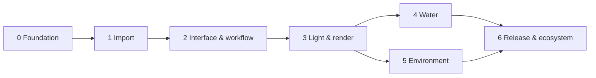

# LightBox Roadmap

The plan, broken into **stages → substages**. Each substage is sized for roughly **one focused AI
session** and has acceptance criteria that define "done" (see `AGENTS.md` §11).

**Legend:** `[ ]` not started · `[~]` in progress / partially done (see note) · `[x]` done.

**Rules**

- Work the current stage's substages in order unless a substage says it can run in parallel.
- A substage that turns out bigger than one session gets split in place (`1.3a`, `1.3b`, …) *before* work
  starts. Never silently drop acceptance criteria; move them to a new substage instead.
- Stages can overlap only where noted. Stage 3 (render) research spikes may start during Stage 2.
- If you change this plan, add a line to `DECISIONS.md` explaining why.

---

## Stage 0 — Foundation

*Goal: a running, cross-platform app skeleton with a Vulkan viewport, a scene document, save/load,
undo and CI, so Stage 1 has something to import into.*

- [x] **0.1 Vision & AI documentation.** `AGENTS.md`, roadmap, architecture, decisions, domain primer,
  building guide, progress log. *Accept:* a fresh AI can find the current task and conventions from
  `AGENTS.md` alone.
- [x] **0.2 Build system.** Top-level CMake, presets (MinGW, MSVC, Linux), pinned FetchContent deps (Vulkan
  headers, volk, VMA, GLM, glslang fallback), build-time GLSL→SPIR-V embedding, warnings module.
  *Accept:* `cmake --preset 
 && cmake --build --preset 
` works from a clean clone with only Qt and a
  compiler installed. *Note:* verified with MinGW 13.1 + Qt 6.10.3; MSVC and Linux presets get verified by
  CI in 0.8.
- [x] **0.3 Qt application shell.** Main window, baseline dark theme, menus with real actions only, status
  bar (GPU, frame time), log file sink, app icon, `--screenshot`/`--quit-after`/`--validation` flags.
  *Accept:* the app starts, shows the viewport, reports the GPU, quits cleanly; screenshot flag works.
- [x] **0.4 Vulkan renderer bootstrap.** Instance/device selection (1.3 baseline + feature checks),
  swapchain presenter per viewport, reverse-Z depth, MSAA, sky gradient, infinite ground grid, test massing
  meshes, orbit/pan/dolly camera, resize/minimize robustness, frame readback for screenshots.
  *Accept:* smooth interaction on an Iris Xe-class iGPU; resizing/minimizing never crashes. *Note:* the
  validation-layer run could not happen on the dev machine (no Vulkan SDK, no admin); it moved to 0.8.
- [x] **0.5 Scene document core.** `lb::Scene` in core: stable entity IDs (64-bit), hierarchy (groups),
  transforms, components (MeshInstance; others arrive with their stages, Views with 2.9), resources
  (Mesh, Material) referenced by ID, change notifications. Renderer mirrors the document through a
  *scene sync* layer instead of the hardcoded test scene, which is deleted.
  *Accept:* test massing is built through the document API; adding/removing/moving an entity updates the
  viewport; unit-testable without GPU. *Note:* the doctest harness from 0.8 was pulled forward to prove
  this (17 tests: scene, scene sync, camera math).
- [ ] **0.6 Project file v0.** Save/load `.lbox` (zip: `project.json` + binary mesh blobs), schema version
  number, migration hook, relative paths for linked sources. *Accept:* save → close → open reproduces the
  scene byte-for-byte in JSON; loading a newer-version file fails with a clear message.
- [ ] **0.7 Command system & selection.** Undo/redo stack (commands with merge for drags), selection set in
  core, click-to-select in viewport (GPU picking via ID buffer), selection highlight outline.
  *Accept:* every document mutation goes through a command; undo/redo round-trips exactly. *Note:* the
  selection set (`core/scene/selection.*`) already exists (pulled forward for the outliner/inspector,
  D-016); the inspector and outliner currently edit the scene directly and must move to commands here.
  Click-to-select in the viewport is pulled forward with a CPU raycast (`core/raycast.*`, D-024); the GPU ID
  buffer and highlight outline remain.
- [ ] **0.8 Tests & CI.** Harness exists (`tests/`, doctest, `ctest --preset`); add file round-trip and
  undo tests as 0.6/0.7 land. GitHub Actions: Windows MSVC + Linux GCC builds and tests, clang-format check, and a Linux job
  that runs `LightBox --validation --screenshot` under Xvfb with Mesa lavapipe + Khronos validation layers.
  *Accept:* CI green on a PR; a deliberately broken test fails CI; the validation job reports zero
  validation errors and uploads the screenshot as an artifact.

## Stage 1 — Import (plans, models, textures, props, plants)

*Goal: anything an architect has can be dropped onto LightBox and look right, with minimal questions,
and updated later without losing work.*

- [x] **1.1 Import pipeline framework.** Importer registry by extension/sniffing, background job system
  (thread pool, progress, cancel), drag-and-drop onto the window/viewport, unit & up-axis detection with a
  non-blocking confirmation toast, origin recentering for far-from-origin models, import report (warnings,
  stats). *Accept:* a dummy importer shows progress, can be cancelled, and reports. *Note (D-021):*
  `src/import/` (lb_import, Qt-free) + Import panel; dispatch by extension (no content sniffing yet); the
  units check is a "Guessed — check" line in the panel's Report instead of a toast; recentering > 10 km.
  Every import is set on the ground (lowest point at z = 0) at the drop point in the viewport, else
  beside the existing content (1 m apart), else at the origin; files without axis information (OBJ, STL, PLY) are stood upright when their geometry
  clearly says so (`core/placement.*`, D-026).
- [~] **1.2 Mesh processing.** Triangulation, vertex welding, normal generation with crease angle,
  MikkTSpace tangents, degenerate/duplicate cleanup, merge-by-material, instance detection (repeated
  blocks/components → instances), meshoptimizer for vertex cache/LOD. *Accept:* a 1M-triangle model imports
  in seconds and renders interactively on the minimum-spec GPU. *Done:* triangulation, angle-weighted
  normals with a 40° crease, degenerate-triangle removal, instancing kept from source files. *Remaining:*
  welding, MikkTSpace, merge-by-material, instance detection, meshoptimizer, the 1M-triangle check.
- [x] **1.3 glTF 2.0/GLB + OBJ/MTL.** fastgltf, tinyobjloader. Materials mapped to the LightBox material
  model (base color, metal/rough, normal, emissive, alpha). *Accept:* Khronos sample models import with
  correct scale/orientation/materials. *Note:* cgltf instead of fastgltf (D-021); emissive and alpha are
  read but wait for the 3.3 material model. Verified with BoxTextured, WaterBottle, Lantern.
- [~] **1.4 FBX, DAE, 3DS, STL, PLY.** ufbx for FBX; Assimp (or focused readers) for the rest; layer/
  material names preserved. *Accept:* FBX exports from Revit/3ds Max/SketchUp import with correct units.
  *Done:* FBX via ufbx (units from the file, Z-up conversion, instancing, PBR + classic materials,
  embedded textures); Collada (`.dae`, SketchUp's free export; units and up axis from the file), KMZ
  (zipped Collada, unpacked with miniz), 3DS, STL, PLY via Assimp with only those importers (D-025).
  *Remaining:* checks with real Revit/3ds Max/SketchUp exports.
- [ ] **1.5 Rhino & SketchUp.** openNURBS for `.3dm` (render meshes, layers, materials, blocks →
  instances). SketchUp `.skp` via the official C SDK as an **optional plugin** (license check recorded);
  without it, guided fallback (export glTF/FBX/DAE). *Accept:* layers/tags become LightBox layers,
  components become instances.
- [ ] **1.6 IFC / BIM.** IfcOpenShell (LGPL, dynamic) or web-ifc core (MPL-2.0) — decide in-session and
  record. Spatial structure (site/building/storey) → outliner groups; IfcMaterial → material slots; element
  types usable for bulk material assignment ("all IfcWindow glass"). *Accept:* a Revit/ArchiCAD IFC
  imports with storeys and sensible materials.
- [ ] **1.7 2D plans: DXF, DWG, PDF, images.** Own DXF reader (ASCII+binary: lines, polylines, arcs,
  circles, splines, hatches, blocks/inserts, text, layers, `$INSUNITS`). DWG through the user-installed ODA
  File Converter (external process) when present. PDF pages via PDFium rasterized as underlays; images as
  underlays. Scale calibration tool (pick two points, type the real distance). Plans placed per storey.
  *Accept:* a typical floor plan DXF appears at correct scale on the ground plane, layer-toggleable.
- [ ] **1.8 Plan-to-3D massing.** Extrude walls from closed polylines/selected layers (height per
  layer/storey), slabs from closed boundaries, simple openings from blocks or gaps, stack storeys.
  *Accept:* from a DXF plan, a clay massing model in under a minute with no modeling tool.
- [~] **1.9 Textures & PBR materials.** Image decode (stb_image, tinyexr; OpenImageIO when Cycles brings
  it), mip generation, BC7/BC5 compression cache (KTX2), PBR map auto-detection from filenames
  (albedo/basecolor/diffuse, normal GL vs DX, roughness/gloss, metal, AO, height), material from a dropped
  folder/zip (Poly Haven / ambientCG naming), real-world texture size, **automatic box/triplanar mapping
  for CAD geometry without UVs**. *Accept:* dropping a Poly Haven texture folder on a wall makes a correct
  material at real-world scale. *Done:* stb_image decode (capped 4096 px), GPU mips, bindless textures,
  map detection incl. packed ARM/ORM and GL-over-DX normals, material from dropped images (applied to the
  selection), triplanar box mapping in meters, normal/AO maps; zip and folder packs (ambientCG, Poly
  Haven, Poliigon naming incl. workflow suffixes, D-023); distance quality: sRGB-correct mips, normal-map specular AA, per-material Variation with distance-faded anti-tiling, optional **random per-tile rotation** (Mapping checkbox, off by default). *Remaining:* EXR (tinyexr), BC7/KTX2 cache.
- [~] **1.10 Asset library core.** Asset manifest (`asset.json`: id, name, category, tags, license, author,
  source URL, real-world size, LODs, thumbnail), SQLite index, user library folders, thumbnail baking via
  the renderer, pack download for CC0 sources (Poly Haven, ambientCG) with license tracking and attribution
  export. *Accept:* install a pack, search it, see thumbnails, export attributions. *Done (textures):*
  online texture library (Materials ▸ Texture library…) searches ambientCG and Poly Haven, downloads
  sets into `%LOCALAPPDATA%/LightBox/Library/Textures` with a JSON record (source, license, size) and
  applies them at real-world size (D-023). *Remaining:* models/props, SQLite index, browsing the local
  library offline, user folders, attribution export.
- [ ] **1.11 Props placement.** Drag from library onto surfaces (raycast, align to surface or up), drop to
  floor, snapping, instancing, quick rotate/scale. *Accept:* place 500 chairs smoothly; they are instances.
- [ ] **1.12 Plants.** Plant asset spec (LOD0–LOD2 meshes + octahedral impostor, two-sided translucent
  leaves, wind parameters, season variants, height/age variation), procedural tree generator
  (Weber–Penn-style) to seed a license-free species library, placement + simple area scatter (full
  ecosystems are 5.5). *Accept:* 20 species presets; 10k trees interactive on mid-range GPUs via impostors.
- [ ] **1.13 Re-import & live update.** File watching, "Update model", matching by stable source IDs /
  layer+material names so user material/asset assignments and placed props survive; diff report.
  *Accept:* change a SketchUp/Revit export, re-import, all overrides intact.

## Stage 2 — Interface & workflow (premium)

*Goal: LightBox feels like paid software: coherent, fast, beautiful, learnable in minutes.*

- [x] **2.1a Design system.** Tokens (color, spacing, radius), theme engine (QSS generated from tokens),
  Inter font (OFL) bundled, Lucide icons (ISC) via QtSvg recolored live, dark + light themes, accent from
  the brand palette. *Accept:* a gallery window showing every control in both themes; no hard-coded colors
  left in widgets. *Note:* `LightBox --gallery [--theme light]`; a `QProxyStyle`, type-scale/motion tokens
  are added when a control needs them.
- [ ] **2.1b Contextual help system.** Built before the tools so every later feature ships with its help
  (see `ARCHITECTURE.md` §12 and D-012). Help entries as data (id, title, one-line summary, how-to steps,
  shortcut, optional image/short animation, "learn more" link), referenced by help ID from actions,
  tools, panels and settings. **Rich tooltips** in the style of Autodesk Fusion: hover shows the summary
  and shortcut; keep hovering (or press F1/Shift) to expand into the how-to with media. Small,
  low-contrast **ⓘ info buttons** next to complex settings/panel headers open the same entry in a popover;
  they never take layout space from primary controls. Setting *Preferences ▸ Help ▸ How-to tips*:
  **Detailed** (default) / **Basic** (summary only) / **Off** (plain tooltips, ⓘ buttons hidden), with a
  one-click toggle in the Help menu. *Accept:* gallery demo of tooltip + ⓘ popover; switching the setting
  takes effect immediately without restart and persists; a lint/test flags any registered action or tool
  without a help entry.
- [x] **2.2 Workflow definition.** Mode-based workflow with per-mode layouts: **Import · Build · Materials ·
  Site · Light · Render**. Written user journeys (first launch → first render in under 5 minutes; update
  model; client presentation; sun study; landscape; interior). *Accept:* journeys documented in
  `docs/WORKFLOW.md` and mirrored by the mode bar. *Note:* D-017, simplified by D-018 after owner feedback.
- [~] **2.3 Main layout & docking.** Mode bar, outliner/library (left), inspector (right), asset strip/
  timeline (bottom), floating viewport toolbar; docking via Qt Advanced Docking System (LGPL) or QDockWidget;
  layout persistence and workspace presets. *Accept:* layout survives restart; panels never stall the UI.
  *Done so far:* header bar with mode bar, mode panel (left, one page per mode), Scene above Properties
  (right), viewport toolbar, theme toggle, per-mode layout persistence + Reset Layout (D-018).
  *Remaining:* asset strip/timeline, named workspace presets.
- [~] **2.4 Viewport overlays & navigation.** Renderer-drawn overlays (view cube, gizmos, safe frames,
  HUD), navigation presets (SketchUp, Revit, Rhino, Blender), walk mode (WASD, eye height 1.6 m, gravity
  optional), frame selected, standard views, **two-point perspective (vertical correction)**, focal length in mm.
  *Accept:* each preset matches its source app's mouse mapping. *Pulled forward:* focal length (8–300 mm,
  quick lenses), two-point perspective, eye level (Render ▸ Camera, D-020); **walk mode** (toolbar *Walk*:
  click where to stand, W A S D / arrows, drag to look, Shift runs, Q/E down/up, Esc; slides along walls;
  CPU raycast `core/raycast.*`, D-024); **orbit modes** (toolbar: around the model, around the point
  under the cursor, look around; remembered); renderer-drawn overlay lines (gizmos, D-026).
- [~] **2.5 Selection & transform tools.** Click/box select, move/rotate/scale gizmos, snapping (grid,
  vertex, edge, face, midpoint), numeric entry, align/distribute, array along line/path. *Accept:* every
  tool undoable; numeric entry respects project units. *Done (D-024, D-026, D-031):* click select, Shift/Ctrl+click adds or removes, a blue outline
  around the selected objects (every mode but Render); move/rotate/
  scale gizmo in Import and Build modes (X/Y/Z arrows, ground square, X/Y/Z rings, X/Y/Z scale squares
  and an even-scale center; Shift snaps 0.1 m / 15° / 10 %; the whole selection, groups once).
  *Remaining:* undo (needs 0.7 commands), box select, geometry snapping, numeric entry, align/distribute, arrays.
- [ ] **2.6 Property system & inspector.** Reflected properties → auto-generated inspector (unit-aware
  sliders, Kelvin/color pickers, texture slots), multi-edit, presets. *Accept:* adding a property to a
  component needs no hand-written widget code.
- [ ] **2.7 Asset browser.** Big thumbnails, categories, search, tags, favorites, hover preview,
  drag-to-viewport. *Accept:* 10k assets browse without hitching.
- [~] **2.8 Material editor.** Live material-ball preview, preset library (concrete, plaster, wood, brick,
  stone, metals, glass, fabrics, tiles), eyedropper from scene, replace-everywhere, texture scale/rotation.
  *Accept:* re-skinning a façade takes three clicks. *Done:* Materials panel with texture slots (file,
  project texture or drag & drop; channel/invert), surface presets, normal/AO, UV/Box mapping with
  scale/rotation/offset, texture grid + preview, apply to selected groups. *Remaining:* material ball,
  preset library, eyedropper, replace everywhere.
- [ ] **2.9 Views manager.** Saved cameras ("Views") with per-view time of day, style, exposure, aspect;
  thumbnails; used by the render queue and animation. *Accept:* switching views is instant and undoable.
- [ ] **2.10 Project management & format v1.** Finalize `.lbox` v1 (package layout, embedded vs linked
  assets, relative paths), autosave + crash recovery, snapshots/versions, start screen (recents, templates,
  sample project), preferences. *Accept:* kill the process mid-edit → recovery restores work.
- [ ] **2.11 Onboarding.** First-run tour (skippable, re-launchable from Help), command palette (Ctrl+K),
  shortcut editor, sample project; help coverage audit of every mode, tool and setting against 2.1b.
  *Accept:* a new user renders the sample project without reading docs.
- [ ] **2.12 Polish & responsiveness pass.** UI thread budget audit (no stalls >16 ms), toasts/notifications,
  i18n infrastructure (Qt Linguist), accessibility basics (keyboard navigation, contrast). *Accept:*
  profiling report attached to `PROGRESS.md`.

## Stage 3 — Light & render (the big one)

*Goal: the Live engine competes with Lumion/D5/Enscape on quality and speed for typical architectural
scenes; the Final engine (Cycles) competes with V-Ray/Corona. Same scene, materials, lights, cameras.*

- [~] **3.1 Render architecture.** Frame graph (automatic barriers, transient resources), bindless resources
  (descriptor indexing + buffer device address), GPU scene buffers, GPU-driven culling foundation, quality
  tiers (**Laptop / Balanced / High / RT**), GPU timestamps profiler overlay. *Accept:* passes declared, not
  hand-synchronized; tier switch at runtime. *Done:* bindless texture table (descriptor indexing) and
  per-frame material buffer via buffer device address (D-021). *Remaining:* everything else.
- [ ] **3.2a HDR target & composite.** The scene (raster or ray traced) renders into a linear HDR image;
  one composite pass applies exposure, white balance, contrast, saturation, tone mapping (Filmic, Neutral,
  AgX, none) and vignette into the swapchain; overlays (gizmos) draw after it. *Accept:* same look as
  before for raster, no per-pass tone mapping left, ray-traced output displays through the same pass.
- [~] **3.2 HDR pipeline & physical camera.** Linear HDR targets, exposure (EV100 / ISO / shutter / aperture),
  auto-exposure (histogram), tonemappers (AgX default, Khronos PBR Neutral, ACES), white balance, bloom,
  vignette, chromatic aberration (subtle), color management (sRGB/Display P3; OpenColorIO optional).
  *Pulled forward (interim, per pass, D-020):* exposure EV, Filmic (ACES fit) / Neutral / none, warmth,
  contrast, saturation, vignette, clay mode (`Scene::look()`, Render ▸ Image).
- [~] **3.3 Materials v1 (GPU).** LightBox material model, aligned with OpenPBR Surface: base, metalness,
  roughness, specular, coat, sheen, transmission (thin and solid), emission, opacity/cutout, foliage
  translucency, normal/bump, height (parallax first). Architecture preset library. *Done:* base color,
  roughness, metalness, normal and occlusion maps, height (parallax), **glass** (transmission, IOR, thin
  panes and solid glass; sorted transparent pass in the raster view; Materials ▸ Glass & glow presets),
  **emission** (nits); glTF see-through materials import as glass. *Remaining:* coat, sheen, cut-out
  opacity (leaves, fences), foliage translucency, presets library.
- [~] **3.4 Sun, sky & lights.** Physically based atmosphere (Hillaire 2020), solar position from
  location/date/time (NOAA/SPA), HDRI environments, sky-light IBL (filtered probes), point/spot/area (rect,
  disk, tube) lights, IES profiles, photometric units (lumens, candela, lux, Kelvin). *Done early:* solar
  position (NOAA, `core/solar.*`, tested), site location/date/time + manual modes, Kelvin sun color, sun
  strength, sky light (Light panel, D-020); point/spot/area lights in lumens and Kelvin (Light panel,
  icons and gizmo in the viewport); **sky images** (`.hdr` panoramas, chosen in Light ▸ Sky or dropped
  on the viewport, turnable; the image's sun becomes the analytic sun, D-028). *Open:* physical
  atmosphere, embedding/collecting linked sky images with the project, brightness calibration, EXR,
  IES, tube/disk lights, light shadows in the raster view.
- [~] **3.5 Shadows.** Cascaded/virtual shadow maps for the sun, local light shadows (atlas), soft area
  shadows (PCSS), contact shadows; RT shadows on the RT tier. *Interim:* one fitted 2048² sun shadow map
  with rotated-Poisson PCF and a softness control (D-020).
- [ ] **3.6 Global illumination (non-RT tiers).** Evaluate and pick (record in `DECISIONS.md`): GTAO +
  screen-space GI + probe volumes (DDGI-style, updated with compute ray marching against an SDF/BVH).
  Interiors are the hard case and the benchmark. *Accept:* a daylit interior looks plausible on the Laptop tier.
- [ ] **3.7 Reflections.** SSR, parallax-corrected reflection probes (per room/zone), planar reflections
  for mirrors/water on raster tiers; RT reflections on the RT tier.
- [ ] **3.8 Ray tracing (the quality renderer, every GPU; owner priority, D-027).** A progressive path
  tracer in Vulkan compute that runs on any Vulkan 1.3 GPU and uses hardware ray tracing where present.
  Low-end machines reach the same quality by taking longer, never by freezing; high-end machines go
  faster or higher.
  - [x] **3.8a Path tracer core.** CPU-built BVH (binned SAH, background thread) over all instances;
    compute shader with BVH traversal, camera jitter, PBR (base color/roughness/metalness/normal maps
    from the bindless table), sun with soft shadows (next-event estimation), sky lighting, glass
    (refraction, Fresnel, thin panes), Russian roulette; progressive accumulation in the HDR target;
    adaptive per-frame time budget from GPU timestamps with work split into tiles (Gentle / Balanced /
    Fast) and a target sample count (Draft / Good / Final), then the GPU idles; Render ▸ Ray traced
    toggle with progress. *Accept:* the sample house with glass converges on the Iris Xe without UI
    stalls; a scene change restarts accumulation. *Done (D-027):* also progress bar with elapsed time and
    time left (Render panel and status bar). Speed on Iris Xe ≈ 1 M pixel-samples/s (Good, 256 samples
    at 1259×770 in ~7½ min); splitting the shader into wavefront kernels is the next speed step.
  - [ ] **3.8b Hardware ray query backend.** BLAS per mesh / TLAS over instances
    (`VK_KHR_acceleration_structure`, `VK_KHR_ray_query`) replacing software traversal when available;
    same images as 3.8a.
  - [ ] **3.8c Denoising.** Albedo/normal guided denoiser (GPU à-trous/SVGF-style first; OIDN where it
    can be built), so previews look clean after few samples.
  - [~] **3.8d Lights and emission in the path tracer.** Point/spot/area lights, emissive materials, IES,
    many-light sampling; HDRI environments with importance sampling. *Done:* point/spot/area lights
    (next-event estimation + MIS, one light picked per bounce), emissive materials, sky images with
    importance sampling (D-028). *Open:* IES, many-light sampling (light BVH) for scenes with dozens of
    lamps.
  - [ ] **3.8e Ray-traced effects in the raster view.** Ray-traced shadows, reflections and GI for the
    interactive view on fast GPUs (with denoising).
- [ ] **3.9 Anti-aliasing & upscaling.** TAA with reactive masks, AMD FSR (MIT) upscaling, transparency and
  foliage stability.
- [ ] **3.10 Cycles integration (Final engine).** Build Cycles standalone as a library
  (`LIGHTBOX_WITH_CYCLES`, MSVC on Windows), scene translation (meshes, instances, materials → Principled
  BSDF, lights incl. IES, sky, camera), progressive render displayed in the LightBox viewport, devices
  (CPU / CUDA / OptiX / HIP / Metal / oneAPI as available), OIDN denoising, presets (Draft / Good / Final),
  light groups for post-render light mixing.
- [ ] **3.11 Look parity Live ↔ Final.** Calibration scenes + automated image comparison (exposure, sun
  intensity, material response) within a documented tolerance.
- [~] **3.12 Output.** Stills up to 8K+ (tiled), render passes/AOVs (beauty, diffuse, specular, emission,
  depth, normal, AO, object/material masks, Cryptomatte), EXR/PNG/JPG/TIFF, batch render queue of Views,
  360° equirectangular panoramas, orthographic elevations/plans, section cut planes with poché.
  **Render screen (owner request):** final images are made on a dedicated render screen, as in
  Lumion — pick the View(s), resolution, quality and output, press Render, watch the progress and
  the image fill in, find results in a gallery — rather than only refining in the editing viewport
  (which keeps the quick preview and the optional ray-traced view). *Done (D-029):* the render
  screen for the current view (File ▸ Render Image…, Ctrl+Shift+R, or Render ▸ Render image…):
  resolution presets or any width × height up to 8192 px, print DPI saved in PNG/JPEG, quality,
  speed, live preview, progress with time left, Save image (PNG/JPEG), offscreen so it never pauses. *Open:* picking saved Views, results gallery, queue.
- [ ] **3.13 Styles & post.** One-click looks (Morning, Golden hour, Overcast, Dusk, Night interior, Clay,
  White model, Sketch/line art outlines), color grading with LUTs, depth of field.
- [ ] **3.14 Animation & video.** Camera paths (keyframes, splines), sun studies (date/time animation),
  simple object animation, motion blur, video encoding (FFmpeg LGPL, dynamic) or OS encoders.

## Stage 4 — Water

*Goal: designer-friendly, parametric water bodies and features that look physically right in Live and
render correctly in Final. Natural water (lakes, rivers, ocean) reuses this core in Stage 5.*

- [ ] **4.1 Water shading core.** Fresnel, refraction with depth-based absorption/scattering
  (Beer–Lambert, water color per body), normal detail, foam masks, underwater fog, screen-space
  refraction + planar/RT reflections, wet-surface shading (darkening + gloss) around edges and splash zones.
- [ ] **4.2 Pools.** Pool from outline (drawn polyline or detected basin), water level, depth; types:
  skimmer, **infinity/vanishing edge** (with spill sheet and catch basin), perimeter overflow, lap pool with
  lane lines; tile materials; underwater lights; animated caustics on floor/walls (Live) and true caustics
  in Final.
- [ ] **4.3 Surface dynamics.** Wind ripples (FFT spectrum scaled to small bodies with fetch), local
  disturbance simulation (GPU height-field waves) for jet impacts and spill points.
- [ ] **4.4 Falls & sheets.** Sheet waterfalls from a weir/lip (ballistic profile from flow rate and lip
  geometry, laminar → broken transition by drop height), rain curtains, scuppers/spouts; flow-mapped
  shading, impact foam and mist particles.
- [ ] **4.5 Jets & fountains.** Nozzle library (vertical, arching, laminar "glass rod", bubbler, foam jet,
  mist/fogger, dome/bell, tulip, crown, deck jets) driven by real parameters (flow, pressure, angle) →
  stream geometry + GPU particles; simple choreography timelines.
- [ ] **4.6 Rills, runnels, channels, cascades, spill bowls.** Water following a spline/channel with
  slope-driven flow maps, stepped cascades, overflow bowls and spillways detected from rim geometry.
- [ ] **4.7 Water feature presets.** Drag-and-drop presets: reflecting pool, wall fountain, cascade steps,
  plaza deck jets, spill bowl, koi pond, runnel.
- [ ] **4.8 Final-engine translation.** Real geometry with displacement, volume absorption, thin
  refractive sheets, instanced droplets, motion-blurred jets, caustic settings.

## Stage 5 — Environment

*Goal: a complete site and context: ground, sky, weather, planting and natural water, set up in one click
and refined with friendly tools.*

- [ ] **5.1 Terrain core.** Height-field terrain with tiled LOD (CDLOD/clipmaps), splat material layers
  with height blending (grass, soil, gravel, rock, snow), displacement detail.
- [ ] **5.2 Terraforming tools.** Brushes (raise, lower, smooth, flatten, ramp, noise), building pads
  (flatten to footprint with batter slope), paths/roads/curbs along splines carving the terrain, retaining
  walls, embankments; undoable sculpting.
- [ ] **5.3 Site data.** Terrain from contour polylines (DXF with elevations → TIN → height field),
  DEM/GeoTIFF import, geolocation (lat/long, true north) feeding the sun, optional OpenStreetMap context
  buildings (ODbL attribution).
- [ ] **5.4 Sky & weather.** Volumetric clouds (presets: clear, cumulus, overcast, storm), fog and aerial
  perspective, rain/snow (particles + wet/snow surface coverage, puddles), global wind driving vegetation,
  water and clouds, night sky (stars, moon).
- [ ] **5.5 Vegetation ecosystems.** Scatter tools (paint, area fill, along path, hedgerow), rules (slope,
  altitude, density maps, exclusion around buildings/paths, species mixes, clustering), GPU instancing with
  HLOD/impostors for 100k–millions of instances, wind animation, seasons, near-camera grass blades with
  distance cards, groundcover.
- [ ] **5.6 Natural water.** Lakes/ponds (drawn shorelines or terrain depressions), rivers/streams along
  splines (flow maps, rapids foam, bank wetness), ocean/coastline (FFT ocean, shore waves, foam).
- [ ] **5.7 Environments (owner request).** One-click settings the house sits in, each owning sky,
  ground, backdrop, fog and vegetation mix: **White studio** (seamless infinite white cyclorama, soft
  shadows, for clean presentation images), **Natural** (meadow, trees, blue sky), Temperate, Mediterranean,
  Desert, Tropical, Nordic, Urban, Night. Picked from a thumbnail gallery; switchable per View (2.9).
  The Light panel has no sky color controls because environments own the sky (D-020). *Accept:* the same
  model renders in studio and natural environments with one click each, and switching back is exact.
- [ ] **5.8 Context & entourage.** People, vehicles, street furniture via the asset library; people/cars
  walking along paths for animations.
- [ ] **5.9 Final-engine translation.** Terrain, instanced vegetation, clouds/fog volumes in Cycles.

## Stage 6 — Release & ecosystem

- [ ] **6.1 Packaging.** Windows installer (Inno Setup/WiX) + portable zip; Linux AppImage/Flatpak; macOS
  via MoltenVK (evaluate feature gaps).
- [ ] **6.2 Updates & crash reports.** Opt-in update check; opt-in crash reporting (Crashpad, BSD).
- [ ] **6.3 Live-link plugins.** SketchUp (Ruby), Revit (C#), Rhino (C#/Python), ArchiCAD: push geometry
  and changes over a local socket, Enscape-style.
- [ ] **6.4 Documentation & tutorials.** User docs site, video tutorials, sample projects.
- [ ] **6.5 Community asset hub.** Curated CC0 packs, contribution guidelines, license manifests.
- [ ] **6.6 Extension API.** Evaluate a scripting/plugin API (e.g. Python) once core formats are stable.
