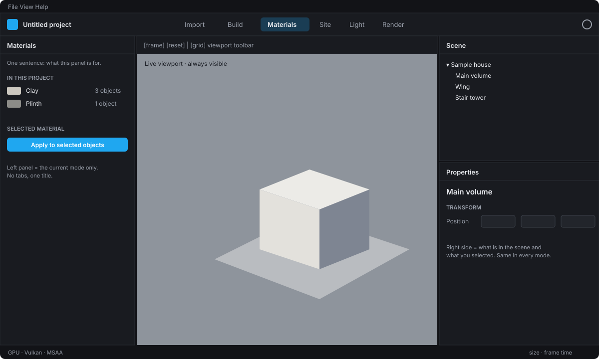

# LightBox Workflow Design

How people move through LightBox: the screen structure, the six modes, the start screen and the user
journeys every feature must serve. Decided with the project owner on 2026-10-14 (D-017) and simplified
after owner feedback on 2026-10-15 (D-018). Implementation status per item is marked **today** or with
the roadmap substage that delivers it.

Read [`DOMAIN.md`](DOMAIN.md) first for who the users are and what they deliver.

## 1. Principles

1. **One viewport, always visible.** Modes change the panels around it, never replace it. The user should
   never lose sight of the design.
2. **Modes guide, they don't lock.** Modes are an ordered path from *model in* to *image out*, but every
   mode is one click (or Ctrl+number) away and selection, camera and undo history carry across.
3. **Left = this mode. Right = your scene.** The left panel shows only the current mode's tools and
   settings, starting with one plain sentence about what it is for. The right side always shows **Scene**
   (what is in the project) above **Properties** (what you selected), in every mode.
4. **Calm, not crowded; powerful, not childish.** One title per panel, no tabs inside panels, no roadmap
   lists in the UI. Inside a mode panel: **presets first**, then **collapsible sections** of dense
   property rows (label column, slider + typed number field, segmented choices), Lumion-level control
   without clutter (D-019). Explanations live in tooltips, not in paragraphs. A mode without tools yet
   shows a short "coming soon" card, nothing more.
5. **Your layout is yours.** Each mode remembers how the user sized or moved the panels.
   *View ▸ Panels ▸ Reset Layout* restores the default.
6. **Drop anything anywhere.** Dropping files on the window switches to Import and starts importing (1.1).
7. **Defaults that already look good,** then presets, then sliders, then *Advanced* (AGENTS.md §3).

## 2. Screen structure

| Area | Content | Status |
| --- | --- | --- |
| Menu bar | File, View (mode, panels, theme), Help | today |
| **Header bar** | Project name · **mode bar** (Import · Build · Materials · Site · Light · Render) · theme toggle; later: Live/Final switch, undo/redo, render button | today (mode bar); Live/Final 3.10 |
| Left panel | The current **mode panel** only: title, presets, then the mode's collapsible sections (`src/app/property_widgets.*`) | today |
| Center | Viewport toolbar (frame, reset view, grid; later view presets, camera, overlays) above the Live viewport | today; overlays 2.4 |
| Right panels | **Scene** (outliner) above **Properties** (name, transform, material of the primary selection) | today (hand-built); generated 2.6 |
| Bottom (optional) | Asset strip / timeline (Render mode animations) | 2.3 / 3.14 |
| Status bar | GPU, frame time, background jobs with progress | today (GPU, frame); jobs 1.1 |

Panels have one title bar and no close buttons; they can be dragged by the title (double-click floats
them) and shown/hidden from *View ▸ Panels*.

**Shortcuts:** Ctrl+1 … Ctrl+6 switch modes. F frame scene, Home reset view, G grid, F2 rename.
Planned: Ctrl+Z/Ctrl+Y undo/redo (0.7), Ctrl+S save (0.6), Ctrl+K command palette (2.11).

## 3. The six modes

The order follows the work: bring the design in, dress it, light it, shoot it.

### Import (Ctrl+1) — "bring my design in"

| | |
| --- | --- |
| Left panel | Drop zone, import queue with progress, recent sources, import report (units found, warnings), **Update model** for every linked source |
| Tools | Plan underlays per storey, scale calibration (pick two points, type distance), plan-to-3D massing |
| Properties | Settings of the selected imported source: units, up axis, origin offset, layer visibility |
| Status | **today:** *Import model…* (Ctrl+I), *Material from textures…*, drop files anywhere (window or viewport); glTF/GLB, OBJ/MTL, FBX, Collada (.dae, SketchUp's free export), KMZ, 3DS, STL, PLY parsed in the background with progress + Cancel, several files queue up. Each model lands as one group, set on the ground where it was dropped (else beside what is already there, or at the origin), stood upright if the file can't say which way is up (OBJ, STL, PLY), then selected and framed with the move/rotate gizmo on it; **Models** lists this session's imports; **Placement**: units (file or guessed, changeable live), Z-up/Y-up, Frame, Select, Place at origin, Remove (deletes only what that import created); **Report**: format, path, counts, time, units source, warnings. Remaining: underlays/plans 1.7–1.8, Rhino/SketchUp/IFC 1.5–1.6, Update model 1.13 |

### Build (Ctrl+2) — "arrange and dress the scene"

| | |
| --- | --- |
| Left panel | The **asset library** (furniture, people, vehicles, props) with drag-and-drop placement; Scene stays on the right |
| Tools | Select, move/rotate/scale gizmos with snapping, place on surface, array, align, simple scatter |
| Properties | Name, transform, material slot, asset info |
| Status | **today:** "coming soon" card for the library plus a quick reference; click an object to select it; **gizmo** (also in Import): drag an arrow to move along X/Y/Z, the square to slide on the ground, a ring to turn, an end square to stretch along that axis, the white middle square to scale evenly; Shift snaps 0.1 m / 15° / 10 %; Properties for exact values. Library 1.10–1.12, undo 0.7, other tools 2.5 |

### Materials (Ctrl+3) — "make it look like what it is"

| | |
| --- | --- |
| Left panel | **Materials in this project** (swatch, name, number of objects using it), material library (presets, CC0 packs) |
| Tools | Apply to selection, select objects using a material, eyedropper, replace everywhere, real-world texture size |
| Properties | Full material editor for the material of the selection (PBR parameters, texture slots, mapping) |
| Status | **today:** action rows (New, From textures…, Apply to selected — works on groups/imported models, Select users, Delete unused; **Include similar objects**, on by default and also used by the texture library: Apply also covers objects named like the selection (Window_01, Window (2), Window.001 → “window”), objects whose material is the same or named alike (Brick_01, brick.002 → “brick”) and same-size copies of it, with a line saying how many more objects that is; made-up names like “Object 12” or “Material14” match only the same name in the same model, D-030); material list with texture thumbnails and usage; sections **Base** (name, color, color map), **Surface** (roughness/metalness + maps with channel/invert, Matte/Satin/Glossy/Metal/Polished presets), **Relief** (normal map, strength, DirectX flip), **Occlusion**, **Mapping** (UV / Box at real-world size, scale, rotation, offset); **Textures in project** grid with preview and *Remove unused*. **Texture library…** (top button) searches ambientCG and Poly Haven (CC0) with category quick-searches and a 1K/2K/4K choice; one click downloads the set into the local library, makes a material at its real-world size and applies it to the selection (groups included). Dropping texture images, a downloaded pack (.zip) or a folder makes one PBR material (ambientCG, Poly Haven and Poliigon naming) and applies it to the selection. Mapping has one-click tile sizes (0.5–5 m), **Variation** (hides the repeating grid of tiled textures from a distance; 0.5 for downloaded sets) and **Rotate each tile randomly** (off by default; for stone, concrete, plaster, ground; not for bricks or planks). Clicking an object in the viewport selects it and shows its material. Remaining: preset library and material ball 2.8, eyedropper/replace everywhere 2.8, full model 3.3 |

### Site (Ctrl+4) — "put it in its place"

| | |
| --- | --- |
| Left panel | Terrain (sculpt, pads, paths), planting (species library, paint/area/line scatter), water (pools, fountains, cascades, ponds, rivers), context buildings, geolocation |
| Tools | Brushes, spline tools, scatter rules, water feature presets |
| Properties | Settings of the selected terrain layer, scatter system, water body or plant |
| Status | **today:** short "coming soon" card. Water 4.1–4.8, environment 5.1–5.9 |

### Light (Ctrl+5) — "set the mood"

| | |
| --- | --- |
| Left panel | Time-of-day presets, **Lights** (add a bulb, spot or panel at the view's focus; edit the selected light: brightness in lumens, color in Kelvin, size, beam), **Sky** (automatic, or a **sky image**: an `.hdr` panorama chosen here or dropped on the viewport, turned with *Turn*; its sun is found and takes over the sun's direction and color), **Sun** (manual direction, or real position from location, date and time; replaced by a note while a sky image is used), **Location** (city, latitude/longitude, UTC offset, true north), **Sunlight** (strength, color temperature, sky light), **Shadows**; later IES profiles |
| Tools | Place lights, aim lights (move/rotate gizmo on the selected light), light groups / light mix |
| Properties | Settings of the selected light |
| Status | **today:** all of the left panel above, live in the viewport, in collapsible sections. Presets are smart in location mode (sunrise, golden hour and dusk are computed for the chosen date). Light icons in the viewport are clickable. Physical sky 3.4, weather 5.4, Environments 5.7 |

### Render (Ctrl+6) — "make the images"

| | |
| --- | --- |
| Left panel | **Render image…** (opens the render screen, below), look presets, **Ray tracing** (photoreal on/off, also `R`; Quality Draft/Good/Final/Ultra; Speed Gentle/Balanced/Fast; progress bar with samples, elapsed time and time left), **Camera** (lens in mm with quick 18/24/35/50/85, two-point perspective, eye level, frame all), **Image** (auto exposure, exposure, tone mapping incl. AgX, contrast, saturation, warmth, vignette, clay model), **Save image**; later Views (saved cameras with thumbnails), render queue, panoramas, animations and sun studies |
| Tools | Live/Final switch, safe frames, batch render |
| Properties | Settings of the selected view (camera, time of day, style, aspect) |
| Status | **today:** everything listed for the left panel except Views and later items; the status bar also shows ray tracing progress and time left in every mode. A dedicated render screen (Lumion-style) is planned with output 3.12. Views 2.9, Final engine 3.10, styles 3.13, animation 3.14 |

**Render screen** (File ▸ Render Image…, Ctrl+Shift+R, or *Render image…* in the Render panel; D-029):
replaces the workspace like the start screen does. The image of the current view fills in on the left;
on the right: **Resolution** (presets: same as the view, HD, Full HD, QHD, 4K UHD, square, portrait 4:5,
or any width × height up to 8192 px, with *Keep proportions*), **Print resolution** (DPI written into
the saved file, quick 72/150/300, with megapixels and print size in cm/in), Quality, Speed, **Render**/Stop, progress with time left,
**Save image…** (PNG/JPEG, also mid-render), *Back to editing* (Esc). Renders offscreen, so covering
the window or switching apps doesn't pause it.

## 4. Workspaces (custom layouts)

- Every mode starts from the same **default layout**: mode panel on the left, Scene above Properties on
  the right.
- Changes the user makes (resizing, moving, floating, hiding panels) are saved **per mode** in
  `QSettings` (`workspace/layout/<mode>`) and restored next time, including across launches.
- *View ▸ Panels ▸ Reset Layout* restores the default for the current mode.
- Workspace presets that users can name and share are a later addition (2.3).

## 5. Start screen (implementation with 0.6 projects and 2.10)

Shown on launch (can be turned off) and from *File ▸ Start Screen*:

| Element | Purpose |
| --- | --- |
| **Import your model** (big button + drop zone) | The fastest path for the first journey |
| New from template | Exterior · Interior · Landscape · Blank: each sets sun, sky, ground and camera defaults |
| Recent projects | Thumbnails, project name, last opened, linked model status |
| Open project… | `.lbox` files |
| Sample project | Pre-built scene to explore features |
| Tips / what's new | One short card, dismissible; respects the How-to tips setting (2.1b) |

Until projects exist, LightBox opens directly into the sample massing.

## 6. User journeys

Each journey has a target time and names the features it depends on. Features that do not serve at least
one journey need a good reason.

### J1 — First image in five minutes (new user, SketchUp model)

1. Launch → start screen → **Import your model** (or drop the `.skp` / `.glb` on the window). *(1.1, 1.3–1.5)*
2. LightBox detects units and up axis, recenters, applies clay or source materials, frames the model,
   sets a pleasant sun and sky. A toast reports what was found; nothing to confirm. *(1.1, 1.2, 3.4)*
3. **Materials:** click the façade → pick *Brick* from the library → it maps at real-world scale even
   without UVs. Same for glass and paving. *(1.9, 2.8)*
4. **Light:** choose the *Golden hour* preset. *(3.4, 3.13)*
5. **Render:** orbit to a good angle, two-point perspective is on by default, **Save image**. *(2.4, 3.12)*

Target: under 5 minutes from launch for a typical small house model.

### J2 — The design changed (update model)

1. Architect edits the model in SketchUp/Revit and re-exports to the same file.
2. LightBox shows *Source changed* on the import; **Import ▸ Update model**. *(1.13)*
3. Materials, placed assets, lights and views survive; a short diff report lists added/removed objects.
4. **Render ▸ Render all views** re-renders the saved views. *(2.9, 3.12)*

Target: under 1 minute of user time.

### J3 — Client presentation day

1. **Build:** add people, cars and furniture from the library for scale. *(1.10, 1.11)*
2. **Site:** plant trees and hedges along the path, add a reflecting pool. *(4.2, 5.5)*
3. **Render:** save four Views (street, garden, living room, aerial) with their own time of day. *(2.9)*
4. Switch to **Final** for photoreal stills, add a 360° panorama, queue everything, render overnight on a
   laptop. *(3.10, 3.12)*
5. Export a short walkthrough video along a camera path. *(3.14)*

### J4 — Sun and shadow study for a planning application

1. **Light:** set the site location (address or coordinates) and true north. *(3.4, 5.3)*
2. Choose the dates (equinoxes, solstices) and hours (9:00–17:00).
3. **Render:** *Sun study* outputs one plan or axonometric image per hour with labeled date/time, or an
   animation. *(3.12, 3.14)*

Must be defensible: solar position from a published algorithm, true north explicit.

### J5 — Landscape architect

1. **Import:** the site plan DXF with contours on its own layer. *(1.7)*
2. **Site:** contours → terrain; flatten a pad for the building; draw paths that carve the ground. *(5.2, 5.3)*
3. **Site:** paint a planting mix (trees, shrubs, groundcover) with exclusion around paths; add a
   cascade water feature from presets. *(4.6, 4.7, 5.5)*
4. **Light / Render:** autumn season, overcast mood, aerial and eye-level views. *(5.4, 5.5, 2.9)*

### J6 — Interior designer

1. **Import:** the room model (FBX/IFC). **Materials:** fabrics, timber, stone with real-world scales.
2. **Light:** place downlights and pendants, drop manufacturer IES files, set 2700 K. *(3.4)*
3. **Render:** wide-angle interior view (16–24 mm) with vertical correction, **Final** render, adjust
   light groups after rendering (light mix). *(2.4, 3.10)*

## 7. Cross-mode behavior

- **Selection** is shared by every mode (core `Selection`); switching modes never deselects.
- **Properties** adapts to the mode: in Materials it opens the selection's material editor first, in
  Light the selected light, in Render the selected view.
- **Undo/redo** spans all modes (0.7). **How-to tips** (2.1b) explain every tool in place.
- **Drop files** → Import mode + import; **click an object** in the viewport selects it (today, CPU raycast;
  Properties and the Materials editor follow); **double-click** → Properties (0.7).
- **Orbit modes** (viewport toolbar, every mode, remembered): orbit around the model, around the point
  under the cursor (SketchUp-style), or look around from where the camera stands.
- **Select** (every mode): click an object; **Shift or Ctrl + click** adds it to the selection or
  removes it (and keeps the selection when clicking empty space). Selected objects get a **blue
  outline**, also where they are hidden behind other objects; Render mode leaves it out, and it is
  never in saved images or renders.
- **Walk** (viewport toolbar, every mode): click where to stand, W A S D / arrows to move, drag to look,
  Shift runs, Q/E down/up, Esc stops. Eye height 1.6 m; you slide along walls instead of passing through.

## 8. How to extend

- New tools/panels belong to exactly one mode (the one whose question they answer). A mode's panel is a
  page in `MainWindow::modePages_` (order = `WorkspaceMode`); start it with a one-sentence intro, group
  controls under section headers, put the most common action (presets, primary button) first.
- Don't add more docks unless a panel is needed in every mode (like Scene/Properties); bump
  `kLayoutVersion` when the dock set changes so stale saved layouts are ignored.
- When a mode's real panel lands, delete its "coming soon" page.
- Update this document's mode tables (status column) in the same session.
